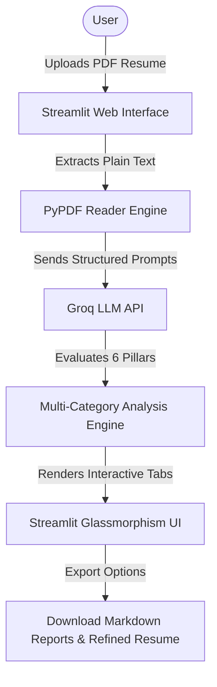

# 📄 AI Resume Analyser

[](https://www.python.org/)
[](https://streamlit.io/)
[](https://groq.com/)
[](LICENSE)

An intelligent, AI-powered resume analysis application built with **Streamlit**, **PyPDF**, and **Groq's Ultra-Fast LLM API** (utilizing `qwen/qwen3.6-27b`, `qwen-2.5-32b`, and `llama-3.3-70b-versatile`). 

The application delivers deep, multi-dimensional evaluations of PDF resumes across **6 core hiring pillars**, specifically optimized for candidates targeting **Full Stack Developer** and modern software engineering roles.

---

## 🌟 Key Features

- 📑 **Instant PDF Text Parsing**: Seamless text extraction from PDF files using `pypdf`.
- ⚡ **Powered by Groq Free-Tier Models**: Super-fast inference with fallback support across Qwen & LLaMA 3.3 models.
- 🎨 **Modern Dark Glassmorphism UI**: High-end responsive Streamlit interface with custom CSS styling.
- 🎯 **6 Comprehensive Analysis Pillars**:
  1. **Content Clarity & Impact**: Evaluates visual hierarchy, active voice, and quantified metrics.
  2. **Skills Presentation**: Tech stack breakdown (Languages, Frameworks, Databases, DevOps) and missing skill identification.
  3. **Experience Descriptions**: STAR method compliance audit and automatic high-impact bullet point rewrites.
  4. **Full Stack Developer Specifics**: Frontend, Backend, Database/DevOps readiness, plus 2 tailored production project recommendations.
  5. **Overall Score & Audit Checklist**: Quantitative score (out of 100), pass/fail checklist matrix, top strengths, and critical areas for improvement.
  6. **Refined ATS-Friendly Resume**: Complete Markdown resume rewrite ready for copy-pasting or downloading.
- 📥 **One-Click Export**: Download the refined resume (`.md`) or the complete evaluation report (`.md`).

---

## 🏗️ Architecture & Workflow



---

## ⚙️ Prerequisites & Environment Setup

### Prerequisites
- **Python 3.10+** installed on your system.
- A free **Groq API Key** (Get one at [console.groq.com/keys](https://console.groq.com/keys)).

---

## 🚀 Quick Start Guide

### 1. Clone & Navigate to Project Directory
```powershell
cd c:\Users\LENOVO\Desktop\Projectgen
```

### 2. Activate Existing Virtual Environment
On Windows (PowerShell):
```powershell
.\.venv\Scripts\activate
```
On Linux/macOS:
```bash
source .venv/bin/activate
```

### 3. Install Dependencies
```powershell
.\.venv\Scripts\python.exe -m pip install -r requirements.txt
```

*Installed dependencies:*
- `streamlit >= 1.30.0`
- `groq >= 0.4.2`
- `pypdf >= 4.0.0`
- `python-dotenv >= 1.0.0`

### 4. Configure Environment Variables
Create or verify your `.env` file in the root directory:
```env
GROQ_API_KEY=your_groq_api_key_here
GROQ_MODEL=qwen/qwen3.6-27b
```

### 5. Run the Application
Launch the Streamlit web server using the virtual environment python runner:
```powershell
.\.venv\Scripts\python.exe -m streamlit run main.py
```
Or with activated environment:
```powershell
streamlit run main.py
```

Access the application in your browser at:
`http://localhost:8501`

---

## 📁 Project Structure

```
Projectgen/
├── .env                 # Environment configuration (API keys, default model)
├── .env.example         # Template for environment variables
├── .gitignore           # Git ignore rules
├── requirements.txt     # Python dependency specifications
├── README.md            # Project documentation
├── main.py              # Main Streamlit web application & Groq API logic
└── .venv/               # Python virtual environment
```

---

## 🔧 Troubleshooting

- **Missing API Key Error**: Ensure `GROQ_API_KEY` is added to `.env` or entered directly into the sidebar text field in the app.
- **Port Conflict (8501)**: If port 8501 is already in use, run Streamlit on a different port:
  ```powershell
  .\.venv\Scripts\python.exe -m streamlit run main.py --server.port 8502
  ```
- **PDF Extraction Issues**: Ensure the uploaded PDF contains selectable text (not scanned images/bitmaps).

---

## 📜 License

This project is open-source and available under the [MIT License](LICENSE).
