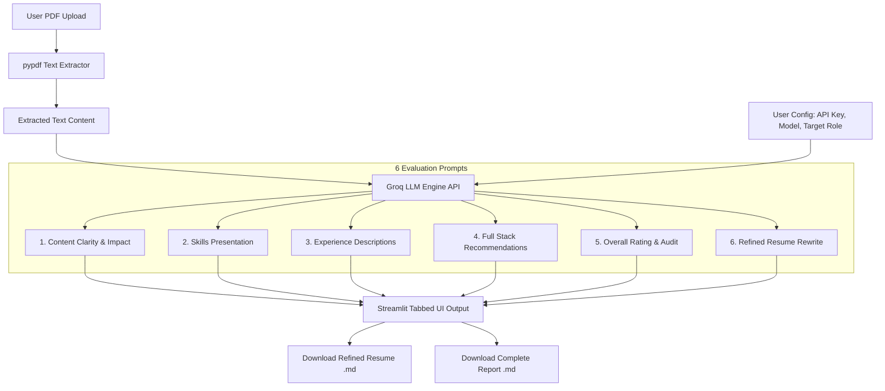

# 📄 AI Resume Analyser

A powerful, modern, single-file Python application built with **Streamlit**, **PyPDF**, and the **Groq API** (featuring fast LLM inference with Qwen 2.5 / Qwen 3.6 / LLaMA 3.3 models). 

The AI Resume Analyser evaluates resume PDFs across 6 core pillars, helping candidates optimize their resumes for Applicant Tracking Systems (ATS) and tech hiring standards (specifically tailored for Full Stack Developers).

---

## 🌟 Features

- 📑 **PDF Resume Parsing**: Extracts raw text cleanly from uploaded PDF files using `pypdf`.
- ⚡ **Groq LLM Acceleration**: Powered by free-tier Groq API models (`qwen-2.5-32b`, `qwen-2.5-coder-32b`, `llama-3.3-70b-versatile`, `qwen/qwen3.6-27b`).
- 🎨 **Glassmorphism UI**: Built with Streamlit, custom CSS, dark mode aesthetics, and dynamic tabbed report views.
- 🎯 **6 Specialized Evaluation Pillars**:
  1. **Content Clarity & Impact**: Visual hierarchy, formatting, passive vs active verbs, quantifiable metrics ($ / % / scale).
  2. **Skills Presentation**: Tech stack breakdown, hard vs soft skills categorization, missing skill gaps.
  3. **Experience Descriptions**: STAR method compliance audit and weak bullet point rewrites.
  4. **Specific Recommendations for Full Stack Developer**: Frontend, Backend, Database, Cloud/DevOps, and portfolio project suggestions.
  5. **Overall Rating & Checklist**: Score breakdown out of 100, pass/fail section audit, top strengths & critical weaknesses.
  6. **Refined Resume**: Rewritten, standardized, ATS-friendly markdown resume.
- 📥 **Export & Downloads**: Download individual refined resumes or full evaluation reports in Markdown (`.md`) format.

---

## 🏗️ Architecture & Workflow

### Architectural Diagram



### Application Workflow
1. **Setup Configuration**: Provide your Groq API Key (from [Console Groq](https://console.groq.com/keys)) and pick your target model and job role in the sidebar.
2. **Upload PDF Resume**: Drag and drop or browse to select your PDF resume file.
3. **Trigger Evaluation**: Click the **🚀 Resume Analyse** button.
4. **Inspect Interactive Tabs**: Review deep insights tab-by-tab across all 6 prompt dimensions.
5. **Download Export**: Export the complete feedback or download your newly rewritten ATS-friendly Markdown resume.

---

## 🚀 Quickstart & Setup Commands

### Prerequisites
- Python 3.9 or higher installed on your system.
- Groq API Key (free tier available at [console.groq.com](https://console.groq.com/keys)).

### 1. Clone or Navigate to Project Directory
```powershell
cd c:\Users\LENOVO\Desktop\Projectgen
```

### 2. Create Virtual Environment (`.venv`)
**PowerShell / Command Prompt (Windows):**
```powershell
python -m venv .venv
```

### 3. Activate Virtual Environment
**PowerShell:**
```powershell
.\.venv\Scripts\activate
```

**CMD:**
```cmd
.\.venv\Scripts\activate.bat
```

**Linux / macOS:**
```bash
source .venv/bin/activate
```

### 4. Install Dependencies
```powershell
pip install -r requirements.txt
```

### 5. Run the Application

**Option A (Direct Venv Path - Recommended for PowerShell):**
```powershell
.\.venv\Scripts\streamlit run main.py
```

**Option B (Activated Virtual Environment):**
```powershell
python -m streamlit run main.py
```

After running the command, open your browser at `http://localhost:8501`.

---

## 📁 Project Structure

```
Projectgen/
│
├── main.py              # Main single-file Streamlit application logic & Groq integration
├── requirements.txt     # Python dependencies (streamlit, groq, pypdf, python-dotenv)
├── README.md            # Comprehensive project documentation & guide
└── .venv/               # Python virtual environment (generated)
```

---

## 🛠️ Model Options

Groq offers fast inference on multiple open models. You can select any of the following in the sidebar:
- `qwen-2.5-32b` *(Recommended for balanced performance & speed)*
- `qwen-2.5-coder-32b` *(Optimized for code and technical resumes)*
- `llama-3.3-70b-versatile` *(High capacity analysis)*
- `qwen/qwen3.6-27b` or Custom Model ID

---

## 📜 License
MIT License. Free for personal and commercial use.
